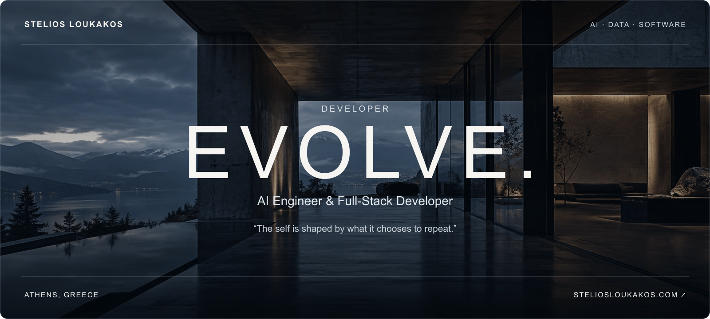
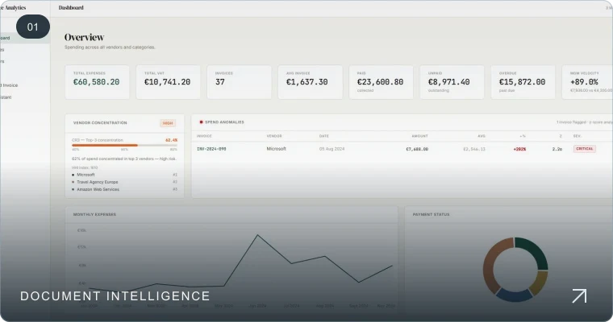
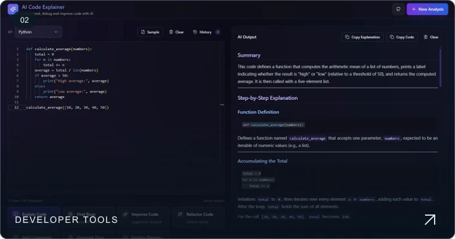
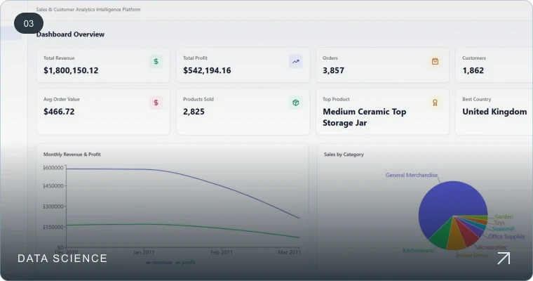
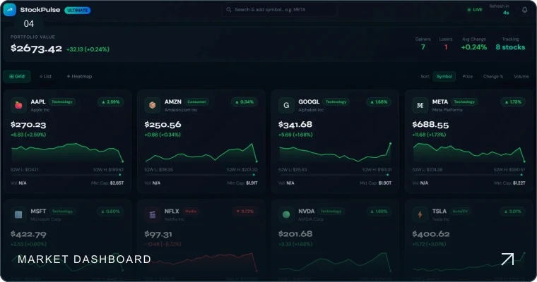
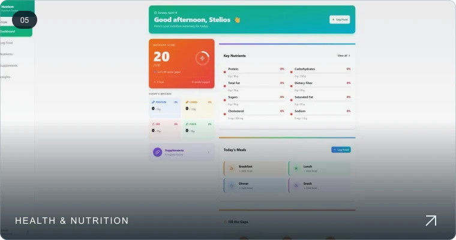
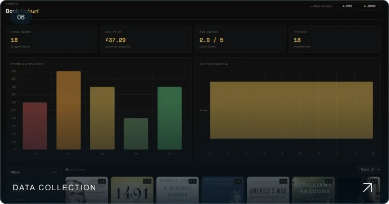

  

  
  
  
  

 

## A little about me.

I’m Stelios, an AI Engineer and Computer Science & Telecommunications student at the **University of Thessaly**, based in **Athens, Greece**. I work across language-model integrations, data applications and the interfaces around them.

I’m interested in the whole system: where the data comes from, how a model is used, and what the person using it actually needs.

### Experience & education

**AI Engineer & Full-Stack Developer | Intern** 
Softbiz, Greece · **Summer 2026 — completed** 
Full-stack development, retrieval-augmented generation (RAG) and fine-tuning.

**BSc Computer Science & Telecommunications** 
University of Thessaly · **2022 — present**

 

## Things I’ve built.

A closer look at my work.

<table>
  <tr>
    <td width="50%" valign="top">
      
      <h3><a href="https://github.com/Stelios-developer/Ai-Invoice-Extraction-System">AI Invoice Extraction</a></h3>
      
Turning PDF and CSV invoices into structured, queryable data.

      
Python · FastAPI · PostgreSQL · pdfplumber

      <a href="https://github.com/Stelios-developer/Ai-Invoice-Extraction-System">View source ↗</a>
    </td>
    <td width="50%" valign="top">
      
      <h3><a href="https://github.com/Stelios-developer/AI-Code-Explainer">AI Code Explainer</a></h3>
      
A code editor with seven focused AI analysis actions.

      
Next.js · TypeScript · Monaco · Anthropic

      <a href="https://github.com/Stelios-developer/AI-Code-Explainer">View source ↗</a>
    </td>
  </tr>
  <tr>
    <td width="50%" valign="top">
      
      <h3><a href="https://github.com/Stelios-developer/sales-customer-analytics-platform">Sales &amp; Customer Analytics</a></h3>
      
From sales CSVs to forecasting and customer segmentation.

      
Python · FastAPI · XGBoost · React

      <a href="https://github.com/Stelios-developer/sales-customer-analytics-platform">View source ↗</a>
    </td>
    <td width="50%" valign="top">
      
      <h3><a href="https://github.com/Stelios-developer/Stock-Pulse">Stock Pulse</a></h3>
      
Market quotes, interactive charts and portfolio tracking.

      
JavaScript · HTML · Tailwind CSS · Yahoo Finance

      <a href="https://github.com/Stelios-developer/Stock-Pulse">View source ↗</a>
    </td>
  </tr>
  <tr>
    <td width="50%" valign="top">
      
      <h3><a href="https://github.com/Stelios-developer/Nutrient-io">Nutrient.io</a></h3>
      
Personalised micronutrient tracking for everyday use.

      
Hono · TypeScript · MySQL · tRPC

      <a href="https://github.com/Stelios-developer/Nutrient-io">View source ↗</a>
    </td>
    <td width="50%" valign="top">
      
      <h3><a href="https://github.com/Stelios-developer/Book-Scraper">BookScraper</a></h3>
      
A scraping workflow with visible progress and clean exports.

      
Python · Flask · BeautifulSoup4 · SSE

      <a href="https://github.com/Stelios-developer/Book-Scraper">View source ↗</a>
    </td>
  </tr>
</table>

<a href="https://steliosloukakos.com/?page=projects">Explore the projects on my website ↗</a>

 

## Tools I work with.

**Engineering** 
`Python` · `TypeScript` · `React` · `Next.js` · `FastAPI` · `PostgreSQL` · `Docker`

**AI & data** 
`RAG` · `Fine-tuning` · `Claude API` · `pandas` · `scikit-learn` · `XGBoost`

 

## Let’s connect.

For a project, an AI engineering opportunity or a conversation about working together:

**[stloukakos@yahoo.com](mailto:stloukakos@yahoo.com)** · [Contact form](https://steliosloukakos.com/?page=contact) · [LinkedIn](https://www.linkedin.com/in/stelios-loukakos-9b52152b2)

---

ATHENS, GREECE &nbsp; · &nbsp; <a href="https://steliosloukakos.com">STELIOSLOUKAKOS.COM ↗</a>

